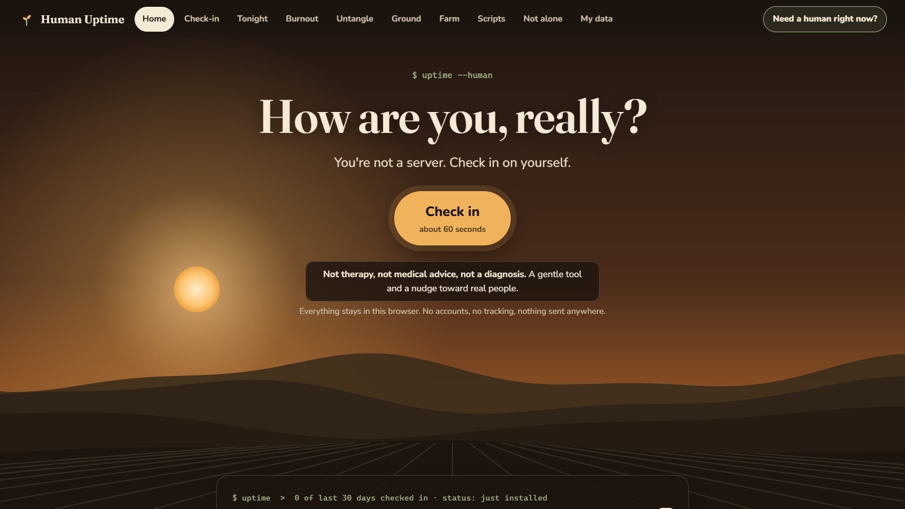
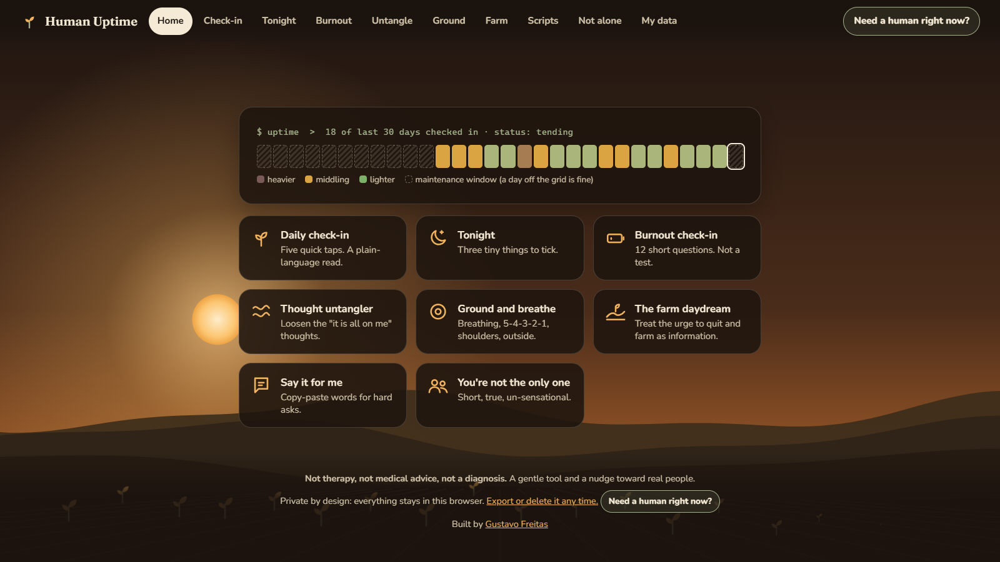

# HUMAN UPTIME

You're not a server. Check in on yourself.

**[Live demo](https://tootenramen.github.io/Human-Uptime/)**

> **Not therapy, not medical advice, not a diagnosis.** A gentle tool and a nudge toward real people.
> If you need a person right now, every screen has a "Need a human right now?" link (988 in the US, findahelpline.com worldwide, your doctor, your EAP, a therapist finder).

A self-care companion for people in security and IT who are tired, stretched thin or thinking about quitting to farm. Warm, short, low-reading.

## What you can do
- **60-second check-in** (energy, mood, sleep, eating, connection) with a soft 30-day "uptime" strip, a plain-language observation and one small suggested action. Missed days are "maintenance windows", never failures.
- **Tonight plan**: three tiny things to tick (something simple to eat, water, step outside, text one person, screens off, lights low).
- **Burnout check-in**: 12 original questions, a gentle profile, "what this might mean" and "what could help this week". Explicitly not a diagnosis.
- **Thought untangler**: reframe "if I miss an alert it's all on me" with evidence, a friend's-eye view and a before/after belief rating, saved to a journal.
- **Grounding**: box breathing, 5-4-3-2-1, shoulders and jaw, step outside, wind-down card, with optional read-aloud.
- **The farm daydream**: treats the urge to quit and farm as meaningful information, then suggests small real ways to get a bit of it this month.
- **Scripts and reassurance**: copy-paste words for hard asks (manager, on-call, handoff, a doctor), and a short "you're not the only one" page.

## How it works
- One `index.html`, 100% client-side. No accounts, no analytics, no network calls except one Google Fonts link.
- Everything is stored in your browser's localStorage. "Export my data" gives you JSON; "Delete everything" removes it all.
- Any free-text field is checked locally for crisis language (for example "I want to kill myself"). If it matches, a kind message and the Help panel appear before anything continues. Ordinary phrases like "this bug will kill me" do not trigger it. It errs toward showing help, so it will sometimes show it when not strictly needed.
- No streaks, no scores, no red failure states. Reduced-motion is respected. Keyboard accessible.

## Skills this shows
Careful product thinking for a sensitive domain, accessible UI, SVG/CSS art, privacy-first design, Playwright end-to-end tests (including the crisis-text matcher).

Built by Gustavo Freitas - [LinkedIn](https://www.linkedin.com/in/gustavo-freitas-69b93910b/) - [more projects](https://github.com/Tootenramen)
